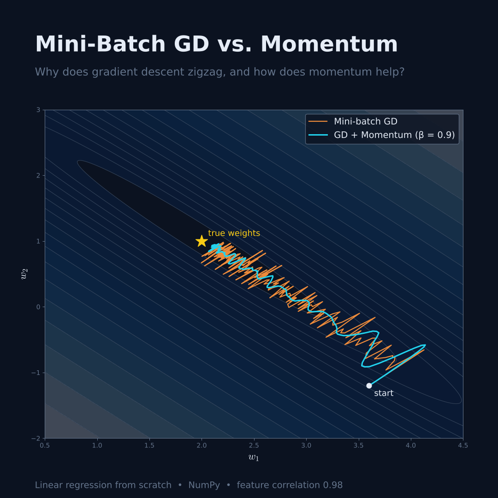
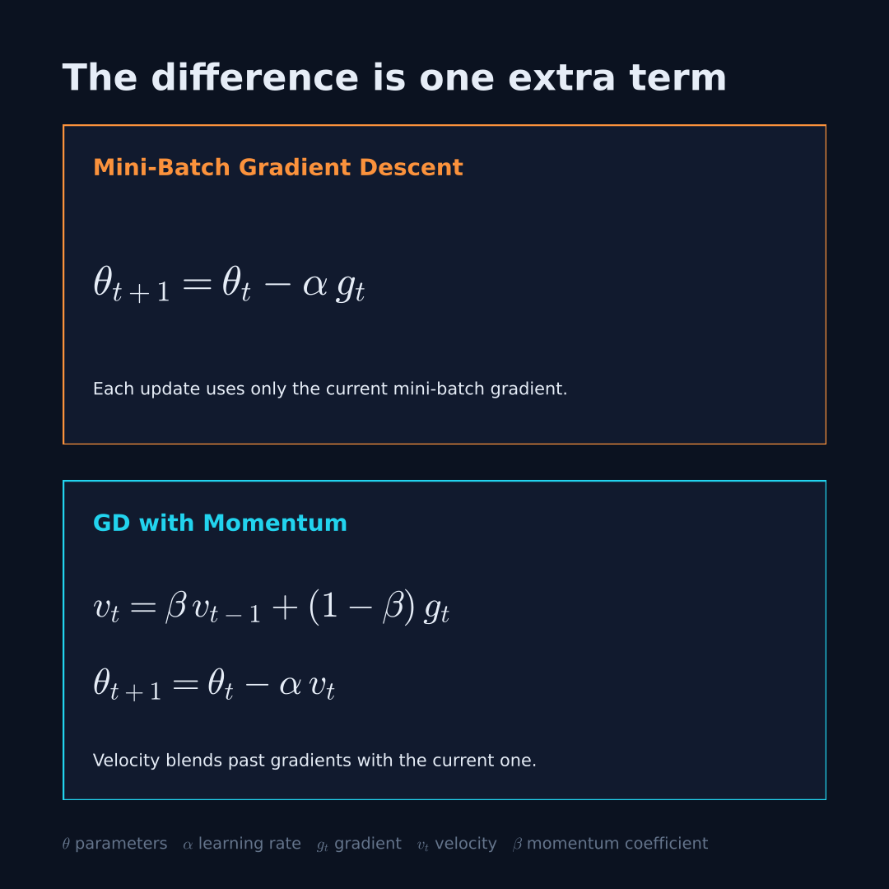
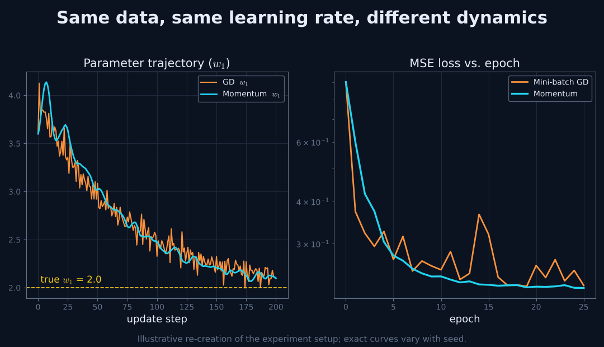

# Mini-Batch Gradient Descent vs. Momentum

**Why does Gradient Descent oscillate during training, and how does Momentum help?**

This experiment implements **Linear Regression from scratch with NumPy** and compares two optimizers on a loss surface designed to make oscillations visible:

- Mini-Batch Gradient Descent (MBGD)
- Mini-Batch Gradient Descent with Momentum

Instead of looking only at final prediction quality, the focus is on **how each algorithm moves through parameter space** during training.



---

## Experimental Setup

Data is synthetic, generated from known parameters, so we can measure how closely each optimizer recovers them.

| Parameter | Value |
|---|---|
| Samples | 256 |
| Input features | 2 |
| Feature correlation | 0.98 |
| Noise std | 0.5 |
| True weights | [2.0, 1.0] |
| True bias | 0.5 |
| Learning rate (α) | 0.40 |
| Batch size | 32 |
| Epochs | 25 |
| Momentum coefficient (β) | 0.9 |

The 0.98 correlation between features produces an **elongated loss surface**, which is where plain gradient descent tends to zigzag.

---

## Algorithms

Both use the same linear model and Mean Squared Error (MSE) loss. Only the update rule differs.

**Mini-Batch Gradient Descent**

```
θ(t+1) = θ(t) − α · g(t)
```

**Mini-Batch Gradient Descent with Momentum**

```
v(t)   = β · v(t−1) + (1 − β) · g(t)
θ(t+1) = θ(t) − α · v(t)
```

where `θ` are the parameters, `α` the learning rate, `g(t)` the mini-batch gradient, `v(t)` the velocity, and `β` the momentum coefficient.



---

## Analysis

The notebook produces four sets of visualizations:

1. **Loss vs. Epoch**: convergence behavior of both optimizers.
2. **Parameter Trajectories**: how `w1` and `w2` evolve relative to their true values.
3. **Loss Surface and Optimization Paths**: the route each optimizer takes across the surface.
4. **Gradient, Velocity and Update Norms**: how Momentum changes the size of each update.

A custom **Zigzag Score** measures how often the direction reverses between consecutive parameter updates.



---

## Key Takeaway

> Gradient Descent determines how parameters move toward the minimum, while Momentum uses information from previous updates to influence their direction and magnitude.

Momentum is not guaranteed to win on every problem. Its effect depends on the learning rate, the momentum coefficient, and the shape of the loss surface.

---

## Project Structure

```
mini-batch-gd-vs-momentum/
├── README.md
├── momentum_vs_mbgd.ipynb      # experiment notebook (rename to match yours)
└── images/
    ├── 1_cover_optimization_paths.png
    ├── 2_update_rules.png
    └── 3_trajectory_and_loss.png
```

## Getting Started

```bash
pip install numpy pandas matplotlib
jupyter notebook momentum_vs_mbgd.ipynb
```

## Future Work

- Compare against **RMSProp** and **Adam**
- Sweep β and the learning rate to see where Momentum helps or hurts
- Test on less correlated features and on non-linear models

---

## Connect

- LinkedIn: https://www.linkedin.com/in/yassin-mohamed-16a028250/
- YouTube: https://lnkd.in/eMZUTZ-d
- Instagram: https://lnkd.in/e-cvPbJm
- TikTok: https://lnkd.in/epSxQPUW
